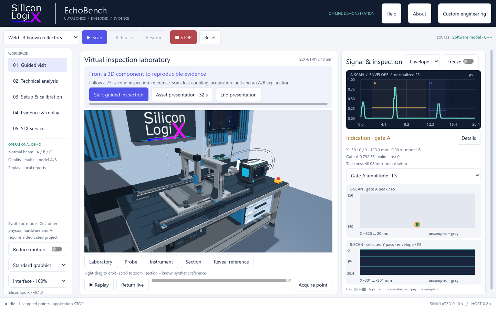

<!-- Silicon LogiX / SLX EchoBench
Copyright (c) 2026 Marco Pezzullo (Silicon LogiX).
License: Silicon LogiX Evaluation License 1.0. See LICENSE. -->
# SLX EchoBench

An offline virtual ultrasonic laboratory for demonstrating the connection between
acquisition quality, executed firmware and reproducible inspection evidence.
Developed by **Silicon LogiX** for technical evaluation and custom engineering.



## Try the Windows demo

For the complete application, open this repository's **Releases** page and download
`SLX-EchoBench-0.1.0-preview.zip`. Extract the whole archive and run `EchoBench.exe`.
Keep `EchoBench.pck`, `bin/` and `runtime/` beside it. The portable works offline
without Python, WSL, a compiler, physical hardware, registration or an account.

This is an **unsigned Windows x64 development preview**. It has been tested on the
desktop described in [verification](docs/VALIDATION.md), including window resizing,
maximized and ultrawide layouts, and adjustable interface scale.

## What runs today

- A declared simplified normal-beam pulse-echo model, known-reflector and intact
  scenarios, manual positioning and bounded serpentine scans.
- Actual recorded RF/envelope, gates, gain/filter, A/B/C scans, coupling quality,
  acquisition-loss faults and a two-reference model calibration.
- Two compiled ThreadX firmware builds executed in native Renode on the **same
  selected saved acquisition**, optionally through a real Verilated FIFO.
- Versioned local SLX API, synchronized recording/replay, annotations, input and
  firmware hashes, and HTML/JSON/CSV reports.
- A validated NDE 4.4 **single-A-scan subset**, with exact native-session roundtrip.
  See the [mapping and restrictions](docs/NDE_MAPPING.md).

Raster acquisition remains the host model. The Renode jobs are a restricted
firmware-processing example, not emulation of a complete commercial instrument.

## Work on the public interface

This repository contains the Godot presentation, public contracts, approved assets,
data-interchange adapter and a matching **binary demo SDK**. The proprietary signal
core implementation, firmware/RTL source, Blender authoring files, private debug
symbols and customer algorithms are excluded.

Requirements for setup: Git, Python 3.12+ and Godot **4.5.2** on Windows x64.

```powershell
python scripts/audit-public.py
python scripts/setup-runtime.py
python scripts/audit-public.py --require-runtime
```

Then open `godot/project.godot` in Godot 4.5.2 and run the main scene. Setup downloads
the official pinned Renode archive and verifies its SHA-256 and every installed
file. Renode is excluded from Git because its executable exceeds GitHub's normal
file-size limit. Setup requires internet once; subsequent application use is offline.
The complete public SDK archive in Releases already includes this runtime.

For an offline setup, supply the official archive already obtained elsewhere:

```powershell
python scripts/setup-runtime.py --archive "C:/Downloads/renode-1.16.1.windows-portable-dotnet.zip"
```

Build the presentation pack with:

```powershell
./scripts/build-interface.ps1 -Godot "C:/Tools/Godot_v4.5.2-stable_win64_console.exe"
```

GitHub Actions audits the source boundary, installs the pinned runtime and Godot,
then runs the public interface/SDK smoke test including compiled firmware/RTL,
session/report persistence and NDE roundtrip. No private checkout or secrets are used.
See [contribution and verification instructions](CONTRIBUTING.md).

## Scope and custom development

The acoustic model and calibration are synthetic. They do not establish real flaw
sizing accuracy, instrument qualification, volumetric coverage or POD statistics.
The NDE mapping does not claim general instrument-file or DICONDE compatibility.

PAUT/FMC/TFM/TOFD, AI assistance, advanced physics, adaptive planning, device/robot
adapters, HIL and enterprise integration are **custom-development services**, with
application-specific feasibility and validation. The in-app services page explains
expected inputs and example deliverables.

[Discuss custom development](https://www.siliconlogix.it/contatti) ·
[Silicon LogiX](https://www.siliconlogix.it/)

## Documentation and license

[User guide](docs/USER_GUIDE.md) · [API](docs/API_SLX_V1.md) ·
[Architecture](docs/ARCHITECTURE.md) · [Validation](docs/VALIDATION.md) ·
[Public/private boundary](docs/DISTRIBUTION.md) · [Changelog](CHANGELOG.md)

Original SLX material is provided under the existing
[Silicon LogiX Evaluation License 1.0](LICENSE). It permits the evaluation described
in that license; this is not an open-source license. Third-party components retain
their own terms: [notices](THIRD_PARTY_NOTICES.md) and `licenses/`. The official Renode
runtime's complete upstream notices are installed by setup and included in the SDK.
